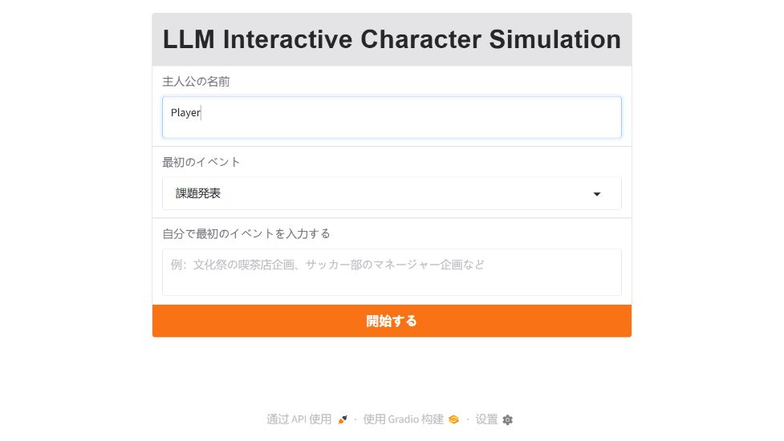
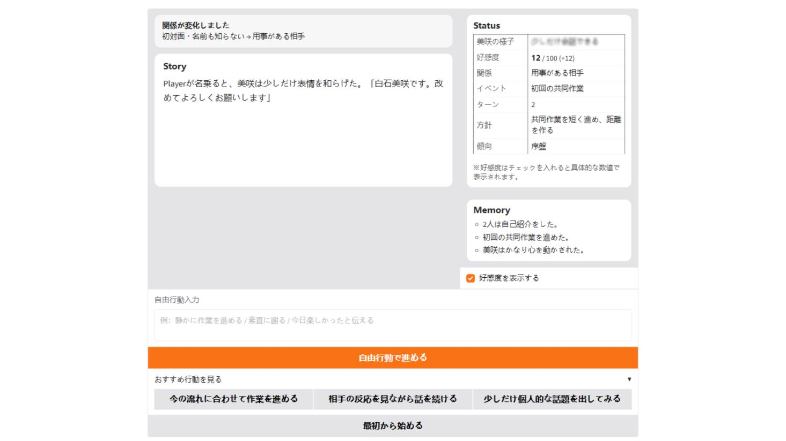
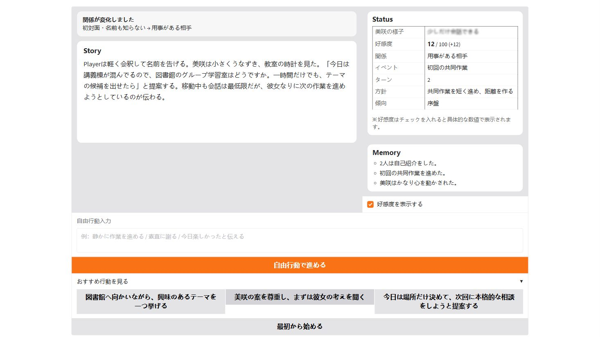

# LLM Interactive Character Simulation

[日本語](README_ja.md) | [简体中文](README_zh-CN.md)

An interactive narrative prototype combining LLM-generated dialogue with deterministic game-state control, staged progression, local fallback, and session-local memory.

## Overview

Built as a Japanese university-life relationship simulation by **PAN YU**, this Python/Gradio prototype explores how generated character behavior can coexist with explicit game rules. Players interact through suggested actions or free text.

**Python owns affinity, caution, progression, and endings; the LLM supplies narrative and action suggestions.** A separate Python random check resolves romance actions, so runs are not fully deterministic.

The project explores a lightweight character-agent pattern constrained by explicit game state and progression rules. It is not a complete autonomous agent: there is no tool calling, planner-executor system, or external-tool integration. Unity integration remains future work.

## Engineering Highlights

- **Clear responsibilities:** Python controls numerical state and progression; the LLM handles narrative expression.
- **Stage constraints:** prompts and choice filtering reduce premature narrative jumps.
- **Failure handling:** local fallback, JSON parsing, and output checks keep interaction playable when generation fails.
- **Recoverable session state:** snapshot copies support a one-time undo.
- **Runtime safety:** HTML escaping and project-local secret loading limit avoidable exposure.

## Demo / Screenshots

Screenshots were captured from the current release using a fictional player name.

**1. Setup**



**2. Local fallback interaction**



**3. Live DeepSeek generation**



## System Architecture — LLM vs. Deterministic Game Logic

```text
Player action → Gradio session → Python keyword rules
                                    ↓
                 Affinity / caution / random romance check
                                    ↓
                         Python chapter transition
                                    ↓
            State + history + event memories → DeepSeek narrative / choices
                                    ↓                  (or local fallback)
                  JSON parsing + story checks + choice normalization
                                    ↓
                  Memory / statistics update → escaped HTML UI
                                    ↓
                  Python ending selection + fixed ending text
```

**Design principle:** the LLM can generate narrative and action suggestions, but it cannot directly overwrite affinity, caution, progression stage, or ending state.

| Responsibility | Implementation in `app.py` |
| --- | --- |
| Interpret action for scoring | Japanese keyword predicates; `calculate_love_change` |
| Resolve romance | `judge_romance_success`; Python random draw against a bounded probability |
| Control progression | `advance_stage`, `is_end_stage`, `make_ending_story` |
| Generate expressive narrative | `make_system_prompt`, `call_ai`; `deepseek-chat` |
| Validate model output | `clean_json_text`, type checks, `is_bad_story_text`, `normalize_choices` |
| Keep per-session state | `gr.State`, `make_snapshot`, `undo` |

The LLM receives already-calculated state. Its generated text can influence keyword-based event memories. The requested `special_action` JSON field is currently unused. JSON is requested in the prompt; this is not provider-enforced schema output.

## Features

### LLM Interaction

- Japanese narrative and three contextual action suggestions, with free-text player actions.
- Four scenario presets or a custom opening theme, using one fixed character persona.
- Stage, session-local history, and event-memory context; up to eight memories retained and four displayed.

### Game-State System

- Affinity, caution/recovery, five progression stages, and five ending states.
- Probabilistic romance checks and one-time snapshot undo.
- Optional affinity display, relationship-change notices, and action statistics.

### Reliability

- Local fallback for missing keys or failed generation.
- JSON parsing, story validation, and choice normalization.
- HTML escaping and project-local secret loading.

## Key Engineering Points

- **Rule execution before generation:** keyword scoring and Python's romance check update state before the model receives its context. Python selects the ending and supplies fixed ending text.
- **Constrained output:** stage-aware prompts describe the current situation; JSON parsing, type/story checks, and choice normalization reject or replace unsuitable output. These checks do not enforce a provider-side JSON schema.
- **Continuity after failure:** local fallback supplies narrative and default choices after API or parsing failures, without changing the scoring rules.
- **State restoration:** snapshots copy event memories and nested statistics for a one-time undo, alongside Gradio session state.
- **Display and configuration safety:** custom HTML escapes text; launch is local-only; dotenv reads beside `app.py`; generic error logs omit exception details.

## Game Flow

Setup → first shared activity → second shared activity → casual conversation → time together → relationship confirmation → result.

Python controls transitions and ending conditions using introduction status, turn count, and affinity. Caution affects interaction and recovery; the LLM expresses the resulting state through narrative and suggested actions.

<details>
<summary>Detailed progression rules</summary>

Progression depends on introduction status, turn count, and affinity; failures can end the story early. The final chapter resolves at turn 38, with an earlier good ending possible from turn 34. A player who never introduces themselves can remain in the first stage indefinitely.

</details>

## Tech Stack

Python, Gradio, python-dotenv, OpenAI Python SDK, and **DeepSeek API** (`deepseek-chat`).

The OpenAI Python SDK is used as an API-compatible client; no OpenAI-hosted model is used. Gemini is not used.

## Setup

Validated dependency versions are pinned in `requirements.txt`, using the versions found on the development machine. Use Python 3.14 (the validation environment); other Python versions are not certified by this release.

Windows PowerShell, from the repository directory:

```powershell
python -m venv .venv
.\.venv\Scripts\Activate.ps1
python -m pip install -r requirements.txt
Copy-Item .env.example .env
# Optionally edit .env and set DEEPSEEK_API_KEY.
python app.py
```

If script activation is unavailable, use `.\.venv\Scripts\python.exe` directly for both pip and app.py. In Windows Command Prompt, activation is `.venv\Scripts\activate.bat`.

Open the localhost URL printed in the terminal, normally http://127.0.0.1:7860. Stop with Ctrl+C. No external assets or original development directory are required.

Without `.env` or a process key, the UI and rules remain playable through local fallback with limited, repetitive text and default choices. Live narrative generation requires a valid DeepSeek key, network access, and available API credit. An invalid key or API error uses local fallback; a responsive UI alone does not prove API success.

For a quick trial, select `課題発表`, start, and enter `丁寧に自己紹介する`. Enable `好感度を表示する` to inspect the change, then try a suggested action or the one-time undo.

## Environment Variables

```dotenv
DEEPSEEK_API_KEY=
```

This is the only application-specific configuration variable. Process environment values take precedence over the optional `.env` beside `app.py`. Never commit a real key. When enabled, the player name, scenario, actions, story history and event memories are sent to DeepSeek; use fictional information for demos.

## Project Structure

```text
app.py                       # rules, prompts, local fallback and UI
requirements.txt             # pinned direct dependencies
docs/screenshots/            # anonymized release UI screenshots
.env.example                 # empty credential template
.gitignore
README.md / README_ja.md / README_zh-CN.md
PORTFOLIO_RELEASE_REPORT.md   # release checks and remaining limitations
```

## Limitations / Future Work

Action scoring uses substring matching, so negation and nuanced language can be misclassified. Random romance outcomes mean runs are not fully deterministic. Prompt constraints and basic filters cannot guarantee narrative consistency. History grows without a token budget; memory is not persistent across sessions. Undo restores game state but not the random generator or exact generated choices. The result's personality labels are playful rule-based summaries, not psychological assessment.

Future directions include bounded history, stronger output validation, more scenarios, and a Unity character presentation layer. There is currently no animation, voice, database, or persistent memory.

## License / Assets

No license is granted in this release pending the author's confirmation of code and prompt ownership. No third-party character art, backgrounds, music or font files are bundled. Dependencies retain their own licenses.
